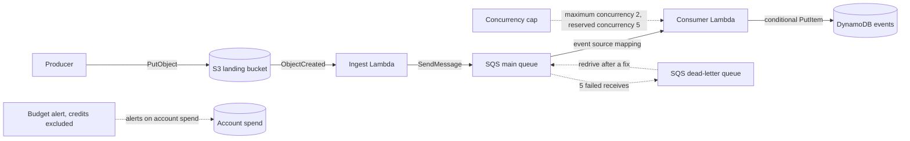
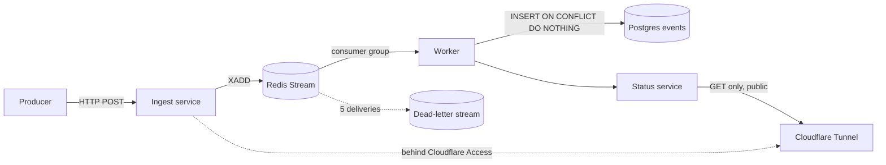

# aws-serverless-pipeline

[](https://github.com/umbra-codex/project-cloud_aws-serverless-pipeline/actions/workflows/ci.yml)

One S3 object becomes one SQS message and then one DynamoDB row. I built it on AWS with OpenTofu and two Node 24 Lambdas, with CI that plans every pull request and every push to `main`, then ported the same design to a Compose stack with Redis Streams, a worker, and Postgres on my homelab. I start the Compose stack on demand for a walkthrough, so it has no public link.

What proves it: see [Proof it works](#proof-it-works).

## What This Is

On AWS it is S3, two Lambda functions on `nodejs24.x`, an SQS queue with a dead-letter queue, and a DynamoDB table. It ran from 2026-11-07 to 2026-11-14, and its evidence is in `evidence/`.

On my homelab, a machine named Seshat running Podman, it is an ingest service, a Redis Stream with a consumer group, a worker, Postgres, and a read-only status service published through a Cloudflare Tunnel.

## Architecture

Solid arrows are the flow, and dotted arrows are failures and returns. The AWS version:



The Compose version:



## How An Event Moves

1. An object lands in the S3 landing bucket, and S3 invokes the ingest function once per object.
2. The ingest function reads the object, adds `landedAt` from the event, derives the idempotency key, and sends one message to the SQS main queue. A burst of uploads waits in the queue instead of hitting DynamoDB all at once.
3. The event source mapping polls the queue and invokes the consumer with up to 10 messages (`batch_size = 10`), at most 2 invocations at a time (`maximum_concurrency = 2`). A message is invisible to every consumer for 180 seconds after delivery.
4. The consumer writes each row with a conditional put on the key, and an existing key counts as success. The mapping deletes the messages that succeeded. `ReportBatchItemFailures` makes the consumer report only the failed messages, so the rest of the batch is not retried.
5. A message that fails five receives (`maxReceiveCount = 5`) moves to the dead-letter queue, and `scripts/redrive.sh` moves it back after the fix.

The key is the body's `idempotencyKey` when it has one, and the decoded object key otherwise. The ingest function derives it once, and the consumer's conditional write enforces it, so a duplicate delivery writes nothing. On Compose, a duplicate POST returns 202 and adds no row. Re-uploading under an existing key counts as the same event and the row keeps the first write. The bucket is versioned, so the corrected object is still in S3.

Compose keeps the same steps with different parts: a Redis Stream for the queue, a consumer group for the mapping, `INSERT ... ON CONFLICT DO NOTHING` for the conditional put, a dead-letter stream for the dead-letter queue, and each entry's delivery count in place of `maxReceiveCount`. The worker blocks on the stream for up to 5 seconds, so there is no polling delay.

## The Benchmark

1,000 events on each runtime. Latency is the row's `processed_at`, set on insert, minus the landing time stamped on the message: the S3 event time on AWS, and the moment the ingest service accepted the request on Compose. Both come from server clocks.

| Runtime | Events | p50 | p95 | Cost |
| --- | --- | --- | --- | --- |
| AWS | 1,000 | 21.38 s | 43.71 s | 0.0080 USD over 8 days (DynamoDB and S3) |
| Compose | 1,000 | 0.93 ms | 1.42 ms | 0 USD of cloud spend; electricity is not counted |

Sources: `evidence/bench-aws-summary.txt`, `evidence/bench-compose-summary.txt`, and `evidence/cost-explorer.txt`.

The AWS latency includes the wait in the queue. Rows arrived over about 40 seconds because the first uploads were already queued when polling started and the consumer was draining a backlog. The likely cause is a concurrency cap, either the mapping's 2 or the reservation of 5 on each function, but I did not read the throttle metric, so it is unconfirmed. The Compose requests were sent one at a time, so its figures are a floor and the columns are not a fair race.

## Proof It Works

- the [passing CI run](https://github.com/umbra-codex/project-cloud_aws-serverless-pipeline/actions/runs/42747746965) that finished the work, including its `static` job
- the [failure drill capture](https://github.com/umbra-codex/project-cloud_aws-serverless-pipeline/releases/tag/drill-capture), a Release asset: 63 seconds, edited from two takes, with the waits sped up and labeled on screen
- [`evidence/README.md`](evidence/README.md), the index of everything captured: the 1,000 latencies for each runtime, the raw AWS rows behind its p50 and p95, the Cost Explorer readings, the destroy log, and the Terraform state taken before the destroy

CI runs `tofu plan` over OIDC on every pull request and push to `main` and never applies, so a passing run shows that the configuration is valid, not that anything is deployed.

## IAM: The Policy, & The Reason For Every Action

Each function has its own role with named statements, and every action is one the function or its event source mapping uses. `PROJECT`, `REGION`, and `ACCOUNT_ID` stand in for the name prefix, region, and account number, which appear in `evidence/terraform-show-before-destroy.txt`. The trust policy that lets CI assume a role is in `terraform/bootstrap/oidc.tf` and names one repository and two contexts.

The ingest function's policy:

```json
{
  "Version": "2012-10-17",
  "Statement": [
    {
      "Sid": "ReadLanding",
      "Effect": "Allow",
      "Action": "s3:GetObject",
      "Resource": "arn:aws:s3:::PROJECT-landing-ACCOUNT_ID/*"
    },
    {
      "Sid": "SendEvents",
      "Effect": "Allow",
      "Action": "sqs:SendMessage",
      "Resource": "arn:aws:sqs:REGION:ACCOUNT_ID:PROJECT-main"
    },
    {
      "Sid": "WriteLogs",
      "Effect": "Allow",
      "Action": ["logs:CreateLogStream", "logs:PutLogEvents"],
      "Resource": "arn:aws:logs:REGION:ACCOUNT_ID:log-group:/aws/lambda/PROJECT-ingest:*"
    }
  ]
}
```

The consumer function's policy:

```json
{
  "Version": "2012-10-17",
  "Statement": [
    {
      "Sid": "WriteRows",
      "Effect": "Allow",
      "Action": "dynamodb:PutItem",
      "Resource": "arn:aws:dynamodb:REGION:ACCOUNT_ID:table/PROJECT-events"
    },
    {
      "Sid": "ReadQueue",
      "Effect": "Allow",
      "Action": ["sqs:ReceiveMessage", "sqs:DeleteMessage", "sqs:GetQueueAttributes"],
      "Resource": "arn:aws:sqs:REGION:ACCOUNT_ID:PROJECT-main"
    },
    {
      "Sid": "WriteLogs",
      "Effect": "Allow",
      "Action": ["logs:CreateLogStream", "logs:PutLogEvents"],
      "Resource": "arn:aws:logs:REGION:ACCOUNT_ID:log-group:/aws/lambda/PROJECT-consumer:*"
    }
  ]
}
```

| Action | Why the code needs it |
| --- | --- |
| `s3:GetObject` | the ingest function reads the landed object |
| `sqs:SendMessage` | the ingest function puts one message on the main queue |
| `dynamodb:PutItem` | the consumer writes the row, with a condition on the key |
| `sqs:ReceiveMessage` | the event source mapping reads from the main queue for the consumer |
| `sqs:DeleteMessage` | the mapping removes a message once the batch succeeds |
| `sqs:GetQueueAttributes` | the mapping reads the queue's settings |
| `logs:CreateLogStream` | each function opens a stream in its own log group |
| `logs:PutLogEvents` | each function writes to that stream |

S3 invokes the ingest function through a resource policy on the function (`aws_lambda_permission` in `terraform/trigger.tf`), not through a statement in either role.

## Why This Cannot Run Away

Two caps and two backstops are why this cannot run away. `maximum_concurrency = 2` on the event source mapping limits the consumer to 2 executions at once, and `reserved_concurrent_executions = 5` on each function caps each at 5. The variable defaults to off, because a 10-unit account cannot host a reservation. AWS raised the limit to 1000 on 2026-11-07, and the 5 was set on the command line at that day's apply.

The budget is 1 USD a month with `include_credit = false`, so a credit cannot hide a charge. It alerts at 80 percent, up to a day late, and cannot stop spend. The destroy ended the exposure. In the 1,000-event burst all 1,000 rows landed and none reached the dead-letter queue (`evidence/sp8-throttling.txt`).

## Cost & Teardown

The AWS stack cost 0.0080 USD over the 8 days it ran, 2026-11-07 to 2026-11-14 (DynamoDB and S3, credits excluded, other services in the account not counted), per `evidence/cost-explorer.txt`. I destroyed it on 2026-11-14, removing 19 resources (`evidence/destroy.log`), and `scripts/check-destroyed.sh`, which I ran afterward, confirmed that no Lambda function, queue, table, or bucket with the project's prefix was left. The Compose stack costs no cloud spend and runs only when I start it; `podman compose down` stops it.

## Decisions

- 2026-10-25: chose OIDC from GitHub Actions over stored access keys because no long-lived credential exists to leak, and the trust policy names one repository and two contexts.
- 2026-10-25: chose two workflows over one because the step tests need Bun on any branch, while the plan needs an identity.
- 2026-10-29: chose a dead-letter queue with `maxReceiveCount = 5` over unlimited retries because a message that fails every time has to stop somewhere a person can read it.
- 2026-10-29: chose a standard queue over FIFO because order is not part of the contract, and the idempotency key already makes a duplicate harmless.
- 2026-10-30: chose `maximum_concurrency = 2` on the mapping over a reserved concurrency per function because the account's Lambda limit was 10, and AWS needs 100 unreserved units before any reservation.
- 2026-10-30: chose an alert-only budget of 1 USD, credits excluded, over treating it as a limit because it reports spend up to a day late and cannot stop anything.
- 2026-10-31: chose a conditional write on `idempotency_key` over deduplicating in the queue because SQS delivers at least once.
- 2026-10-31: chose `ReportBatchItemFailures` over failing the whole batch because one bad message should not send nine good ones back to the queue.
- 2026-11-01: chose a Compose port with Redis Streams and Postgres over keeping the AWS stack running because the AWS stack was always going to be destroyed and would leave nothing to demo, and Compose is the version that costs nothing in cloud spend.
- 2026-11-07: chose a reserved concurrency of 5 on each function over leaving it off because AWS had raised the account's Lambda limit to 1000 and the mapping cap bounds only the consumer.
- 2026-11-08: chose to report AWS latency from landing to row, queue wait included, over a per-invocation duration because the product is a row and not a function call.

## License

MIT, see [LICENSE](LICENSE).
